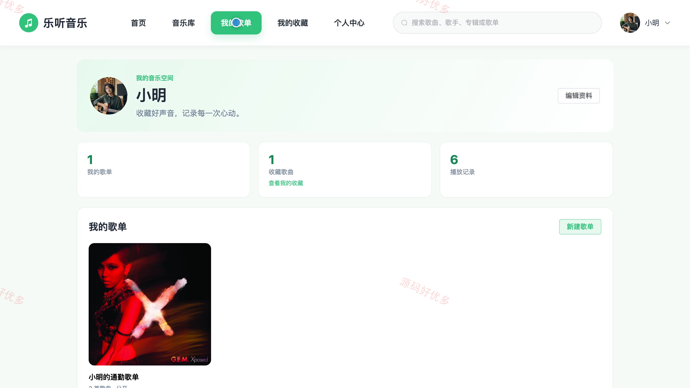
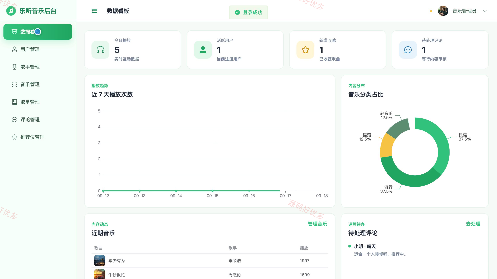
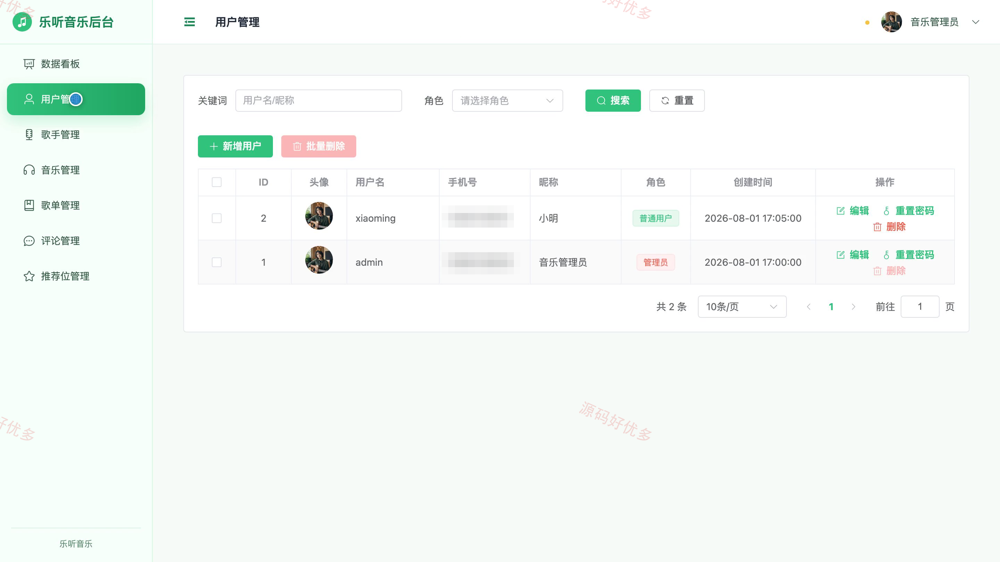
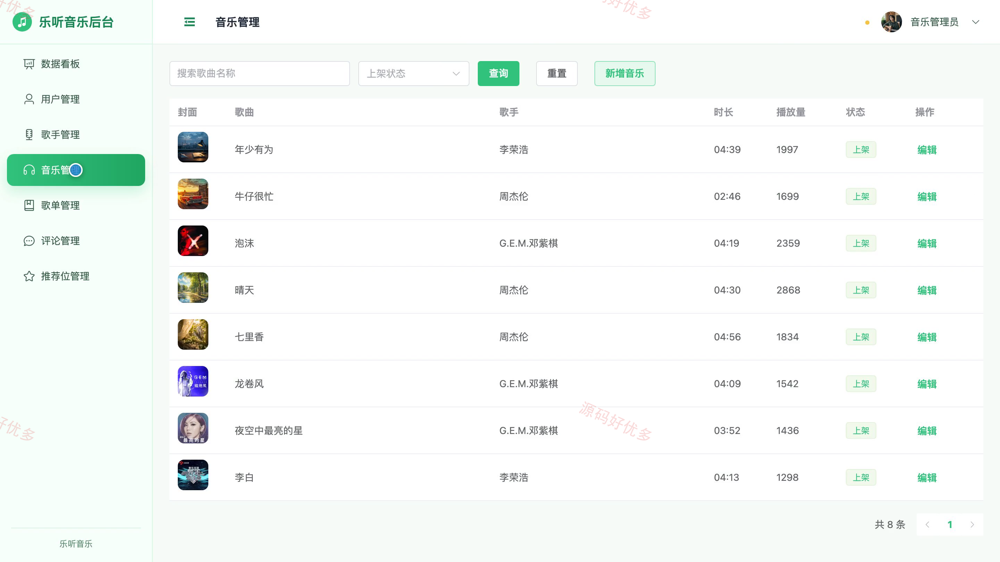
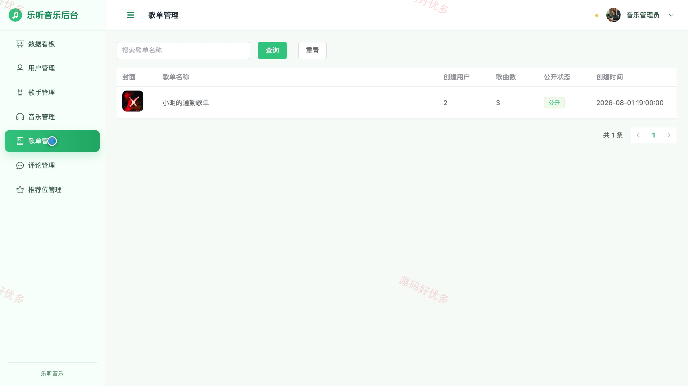

## 源码问题查看主页咨询

### 一、关键词
在线音乐、歌曲播放、音乐收藏、歌单管理、音乐推荐

### 二、作品包含
源码+数据库+万字设计文档+PPT+全套环境和工具资源+本地部署教程

### 三、项目技术
前端技术： Html、Css、Js、Vue3.4、Element-Plus
后端技术：Python、Django

### 四、运行环境要求
开发工具：PyCharm + VSCODE

数据库：MySQL5.7+（共9张表）

数据库管理工具：Navicat10以上版本

环境配置软件： Python3+

前端Nodejs：16+

浏览器：谷歌浏览器

### 五、项目介绍
项目编号：bs016C

本项目面向在线音乐浏览与运营管理场景，用户可浏览推荐音乐、搜索歌曲、在线播放、收藏歌曲、查看歌单和播放记录，并提交歌曲评论；管理员可维护用户、歌手、歌曲、歌单与首页推荐位，同时完成评论审核和运营数据查看。

角色：用户、管理员

用户功能：注册登录与账户安全、首页推荐音乐浏览、音乐库搜索与筛选、歌曲详情与在线播放、歌曲收藏与取消收藏、个人歌单与播放记录查看、歌曲评论提交、个人资料与密码维护。

管理员功能：音乐运营数据统计、用户账号管理、歌手资料管理、歌曲信息管理、用户歌单管理、评论审核与删除、首页推荐位管理、个人资料维护。

### 六、运行截图

